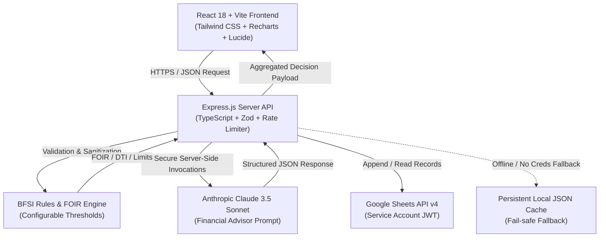

# FinAI – Architecture & System Design

## 1. System Overview

FinAI is a production-grade Banking, Financial Services, and Insurance (BFSI) financial decision-support platform designed to calculate retail loan eligibility, evaluate credit health, compute real-time EMI amortizations, and generate structured financial guidance using Anthropic Claude 3.5.

---

## 2. Frontend Layer (`/client`)

The frontend is structured into modular, reusable components adhering to a **Dark Glassmorphism UI System**:
- **Design Tokens:** Deep obsidian backgrounds (`#070b14`), glass-effect cards (`backdrop-blur-md`, subtle border highlights), and accessible color coding for risk levels (Emerald for Low, Amber for Moderate, Rose for High).
- **Core Views:**
  1. `LandingPage`: Product showcase, benefits, workflow steps, security badge, and compliance disclaimer.
  2. `DashboardPage`: Real-time financial dashboard with 4 interactive Recharts (Cash Flow, DTI Donut, Credit Radar, Loan Affordability Curve).
  3. `LoanEligibilityPage`: Comprehensive loan assessment form with instant FOIR/DTI estimation, factor breakdown, and Google Sheets save.
  4. `CreditAnalyzerPage`: Semicircle gauge diagnostic of credit score percentile, utilization ratio, and debt burden.
  5. `EmiCalculatorPage`: Live reducing-balance EMI calculator, principal vs. interest breakdown, and printable amortization schedule.
  6. `AiFinancialTipsPage`: Claude AI integration providing structured advice, risk factors, and lender interrogation checklists.
  7. `FinancialProfilePage`: User profile manager with automatic cross-tool synchronization.
  8. `HistoryPage`: Previous calculation history with search, filtering, sorting, mobile card conversion, and CSV export.
  9. `AboutDisclaimerPage`: Regulatory disclosure, underwriting heuristics explanation, and one-click data purge.

---

## 3. Backend & API Layer (`/server`)

The backend is built with **Node.js, Express.js, and TypeScript**:
- **Layered Architecture:** Clear separation between Routes, Controllers, Services, Middleware, and Validators.
- **Configurable Thresholds (`/config/thresholds.ts`):** Banking limits such as FOIR ceilings (40% - 60%), DTI cutoffs, and benchmark interest rates are isolated in configuration files for easy institutional adjustment.
- **Resilience & Graceful Degradation:**
  - If `ANTHROPIC_API_KEY` is not provided, the system seamlessly uses a high-fidelity rule-based BFSI intelligence engine.
  - If `GOOGLE_*` credentials are not configured, the server defaults to persistent local JSON storage in `server/data/records.json`.

---

## 4. Security Architecture

1. **Secret Isolation:** External credentials (`ANTHROPIC_API_KEY`, `GOOGLE_PRIVATE_KEY`) are restricted to server-side memory and never exposed to the client bundle.
2. **HTTP Hardening:** Custom security headers (`X-Content-Type-Options: nosniff`, `X-Frame-Options: DENY`, `X-XSS-Protection`).
3. **Rate Limiting:** In-memory sliding-window limiter enforcing 100 requests per 15 minutes for general APIs and 40 requests per 15 minutes for AI endpoints.
4. **Input Sanitization & Schema Validation:** Dual validation with Zod on both client and server.
5. **No Hard Credit Pulls:** The platform conducts soft estimations based solely on user-provided values, ensuring zero bureau impact on actual CIBIL/Experian credit scores.
