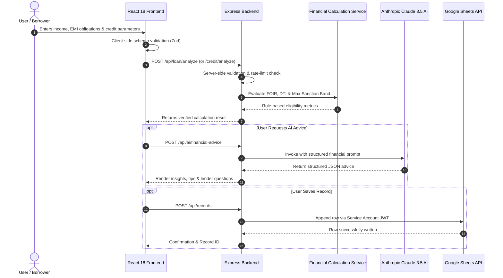

# FinAI – End-to-End Workflow & Calculation Methodology

## 1. Data Flow Pipeline

Conforming to Section 26 of the FinAI system design:

---

## 2. Calculation Mechanics

### Debt-to-Income (DTI)
$$\text{DTI} = \left(\frac{\text{Existing Monthly Obligations}}{\text{Total Monthly Income}}\right) \times 100$$

### Fixed Obligation to Income Ratio (FOIR)
$$\text{FOIR} = \left(\frac{\text{Existing Monthly Obligations} + \text{Proposed Loan EMI}}{\text{Total Monthly Income}}\right) \times 100$$

### Standard Reducing-Balance EMI Formula
$$\text{EMI} = P \times r \times \frac{(1 + r)^n}{(1 + r)^n - 1}$$

- $P$ = Principal Loan Amount
- $r$ = Monthly interest rate ($\text{Annual Rate} / 12 / 100$)
- $n$ = Number of installments in months
- For zero-interest loans: $\text{EMI} = P / n$
